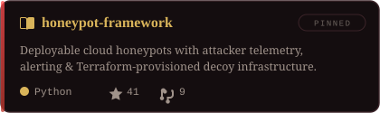
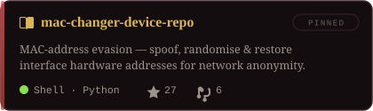
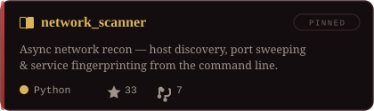
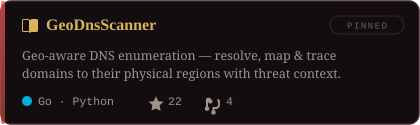

<p align="center">
  
</p>

<p align="center">
  <a href="https://linkedin.com/in/moksh-vatsa-a34885404"></a>
  <a href="mailto:vatsamoksh@gmail.com"></a>
  <a href="https://instagram.com/notmytypebruhh"></a>
  
</p>

## § I · whoami

```python
#  grimoire://moksh — page 1 of ∞
class Moksh(Hacker):
    year     = "2nd-year student"
    affinity = ["cybersecurity", "machine learning", "DSA in Python"]
    spells   = ["cloud honeypots", "network recon", "MAC evasion"]
    training = ["Rust"]
    hobby    = "surfing the internet"
```

## § II · spellbook

<p align="center">
  <a href="https://github.com/Sickwoman/honeypot-framework"></a>
  <a href="https://github.com/Sickwoman/mac-changer-device-repo"></a>
  <a href="https://github.com/Sickwoman/network_scanner"></a>
  <a href="https://github.com/Sickwoman/GeoDnsScanner"></a>
</p>

## § III · arsenal

| | |
|:--|:--|
| **TONGUES** |       -FF4D4F?style=flat-square&logo=rust&logoColor=140D0F) |
| **SUMMONS** |      |
| **DIVINATION** |      |
| **CONSTRUCTS** |       |

## § IV · battle log

<p align="center">
  
  
</p>

<p align="center">
  
</p>

<p align="center"><sub><b>— THE GRIMOIRE CLOSES —</b><br/><code>&gt; session terminated · thanks for stopping by</code></sub></p>

<!--
  The serpent above is regenerated from the live contribution graph by
  .github/workflows/serpent.yml (daily + on push). Until the first run,
  it shows a hand-authored placeholder serpent committed to profile/serpent.svg.
-->
