<div align="center">

<picture>
  <source media="(prefers-color-scheme: dark)" srcset="./assets/breakdown-hero-dark.svg">
  
</picture>

<br/>


<br/><br/>

<a href="#experience">Experience</a> ·
<a href="#open-source-security">Open Source</a> ·
<a href="#changelog">Changelog</a> ·
<a href="#projects">Projects</a> ·
<a href="#arsenal">Arsenal</a>

</div>

Third-year student who builds traps for attackers and the tools that watch them. I run cloud
honeypots, write service-fingerprinting modules for **OWASP Nettacker**, and harden and extend
**The Honeynet Project's** ochi, the live UI for Glutton honeypot events. On the research side I
test ML claims against hard limits, from catching byzantine nodes in multi-party computation to
predicting antibiotic resistance across hospitals.

---

## Experience

<table>
<tr>
<td width="170" align="center" valign="middle">

</td>
<td valign="top">

**SDE Intern** · Great Research Software Solutions &nbsp;<sub>`Jan 2026 → Mar 2026` · `Noida, India`</sub>

Co-designed the end-to-end N-tier specification for a **UK-regulated remittance platform**.

- **63 user stories, 6 architecture layers, zero circular dependencies** across the specification.
- **6 swappable vendor interfaces, zero vendor lock-in:** built and unit-tested the compliance logic against mocks before any vendor contract closed.
- **Zero ambiguous transaction states:** modelled the transfer engine as an explicit state machine, with every transition audit-logged.

`N-tier Architecture` · `Remittance` · `Compliance` · `State Machines`

</td>
</tr>
</table>

---

## Open Source Security

&nbsp; **[OWASP/Nettacker](https://github.com/OWASP/Nettacker)** · automated penetration testing and vulnerability scanning framework &nbsp;<a href="https://github.com/OWASP/Nettacker/pulls?q=is%3Apr+is%3Amerged+author%3ASickwoman"></a>

> **Version fingerprinting modules and port-scan coverage** · <sub>`#1832` · `#1878` · `#1890` · `Nov 2026`</sub>
>
> Wrote `grafana_version_scan` and `plex_version_scan`. Each reads the version from the service's
> unauthenticated endpoint (`/api/health`, `/identity`) and reports it as a fingerprint, with no CVE
> claim attached. Then fixed a coverage gap: port scan only probed Nmap's default port list, and with
> service discovery on, Nettacker drops every module whose port it didn't find. Modules on seven
> default ports never ran, including three CISA KEV checks (SonicWall SSL-VPN, Langflow, SmarterMail).
> Port scan now probes every module's default port.
>
> <sub>In review: `prometheus_version_scan` (#1930)</sub>

&nbsp; **[honeynet/ochi](https://github.com/honeynet/ochi)** · The Honeynet Project's live UI for Glutton honeypot events &nbsp;<a href="https://github.com/honeynet/ochi/pulls?q=is%3Apr+is%3Amerged+author%3ASickwoman"></a>

> **Authentication, sensor trust and CI hardening, plus query-language features** · <sub>`Oct – Nov 2026`</sub>
>
> Moved bearer auth onto `go-chi/jwtauth`, so a refused token now answers `401` instead of `500`
> (#167). Made the server reject events from unregistered sensors, checking the full sensor UUID
> rather than the 8-character display prefix, which would have been enough to impersonate one (#169).
> Gave the Actions workflows `permissions:` blocks, credential-free checkouts, timeouts and
> cancellation of superseded runs (#206). In the query DSL: `payload matches "<regex>"` (#219), plus
> scanner and transport filters (#194, #172).
>
> <sub>In review: generate secrets instead of shipping the default `jwt_secret` and `publish_token` (#237) · accept the publish token from a header, not just the URL (#201)</sub>

---

## Changelog

```diff
@@ sickwoman — recent activity @@
+ [2026-11]  OWASP/Nettacker · #1878 merged → plex_version_scan module
+ [2026-11]  OWASP/Nettacker · #1890 merged → port scan probes every module's default port
+ [2026-11]  honeypot-framework · #13 → Docker stack now turns Cowrie attacks into alerts, demo kit
+ [2026-11]  OWASP/Nettacker · #1832 merged → grafana_version_scan module
+ [2026-11]  honeynet/ochi · #219 merged → payload matches "<regex>" in the query DSL
+ [2026-10]  honeynet/ochi · #206 merged → hardened the GitHub Actions workflows
+ [2026-10]  honeynet/ochi · #169 merged → events from unregistered sensors rejected
+ [2026-10]  honeynet/ochi · #167 merged → bearer auth moved to go-chi/jwtauth
+ [2026-03]  Completed SDE internship · Great Research Software Solutions, Noida
! [review]   OWASP/Nettacker #1930 · prometheus_version_scan
! [review]   honeynet/ochi #237 · generated secrets instead of shipped defaults
```

---

## Projects

<p align="center">
<picture>
  <source media="(prefers-color-scheme: dark)" srcset="./assets/breakdown-script-dark.svg">
  
</picture>
</p>

<table>
<tr>
<td width="50%" valign="top">

### ❯ [MPC Node Threat Detection](https://github.com/Sickwoman/MPC-node-threat-detection)

A passive, share-free network monitor for multi-party computation. Over 100 real 3-party sessions it
catches dropped and duplicated messages with precision 1.00 and zero false positives, even under TLS.
It also maps the limit: a tampered Shamir share is statistically identical to an honest one, so
detection there is 0% and cryptographic malicious security has to take over.

`MPC` · `Network Monitoring` · `ML` · `Python`

</td>
<td width="50%" valign="top">

### ❯ [Antibiotic Resistance AI](https://github.com/Sickwoman/antibiotic-resistance-ai)

Research prototype that predicts antibiotic resistance from MALDI-TOF mass spectra (DRIAMS), focused
on whether models hold up across hospitals and over time. The frozen ciprofloxacin model was evaluated
once, under a pre-registration, on an independent hospital's public data. Not a clinical tool.

`ML Research` · `Generalization` · `Python`

</td>
</tr>
<tr>
<td width="50%" valign="top">

### ❯ [Honeypot Framework](https://github.com/Sickwoman/honeypot-framework)

Cloud-native honeypot deployment: Cowrie SSH and OpenCanary decoys feeding an Elasticsearch, Logstash
and Kibana pipeline, with modular Terraform for multi-region AWS and an attack-simulation harness that
exercises the whole detection path locally.

`Honeypots` · `ELK` · `Terraform` · `AWS`

</td>
<td width="50%" valign="top">

### ❯ [SOC & Forensics Worklet Program](https://github.com/Sickwoman/soc-forensics-worklet-program)

A 12-week lab program in ten worklets, each built as documentation, a prototype and a working model:
pfSense with Snort, VLAN zero trust on VyOS, WireGuard, a Wazuh/ELK SIEM, OpenVAS, FreeIPA with MFA,
a ModSecurity WAF, then memory, disk and network forensics with Volatility 3, Autopsy and Wireshark.

`SOC` · `DFIR` · `Network Defense`

</td>
</tr>
</table>

**Also:**
[MAC Changer](https://github.com/Sickwoman/mac-changer-device-repo) (Kali, random MACs, timed rotation) ·
[Network Scanner](https://github.com/Sickwoman/network_scanner) ·
[Rust Learning](https://github.com/Sickwoman/Rust-learning-)

---

## Arsenal

```console
$ tree ~/arsenal
~/arsenal
├── honeypots/     Cowrie, OpenCanary, Glutton events, ELK pipelines, alerting
├── recon/         service fingerprinting, port scanning, OWASP Nettacker modules
├── appsec/        auth and token handling, secret defaults, CI / Actions hardening
├── ml-research/   scikit-learn, TensorFlow / Keras, generalization and calibration
└── infra/         Terraform, AWS, Docker, GitHub Actions
```

<p align="center">


</p>
<p align="center">


</p>
<p align="center">


</p>

---

<div align="center">

<picture>
  <source media="(prefers-color-scheme: dark)" srcset="./assets/breakdown-end-dark.svg">
  
</picture>

<br/><br/>

<a href="https://linkedin.com/in/moksh-vatsa-a34885404"></a>
<a href="mailto:vatsamoksh@gmail.com"></a>
<a href="https://instagram.com/notmytypebruhh"></a>

<br/><br/>

</div>

<details>
<summary><sub>Reading the breakdown</sub></summary>

- **The shot:** one tower per day of the last 12 months and one row per week, laid out like the contribution calendar (Sunday on the left). A tower is as tall as that day was busy, relative to my busiest day. This week is nearest the camera; the oldest week recedes toward the sun.
- **The passes:** wireframe, clay, normals and depth are the render passes a CG artist checks before a shot goes out. The opening shot wipes through them to the final beauty pass, the way a breakdown reel does.
- **The timeline:** one frame per day, from frame 1001 (where shots start) to 1365. Bar heights are daily contributions, and the diamond marks my busiest day.
- **Comp script:** the year is the background plate. Featured repositories are Read nodes merged over it, each with a material preview in its language colour. The result is graded, then written out as version v101: one version for every active day.
- **Colour chart:** language share by bytes across public repositories, above a grey ramp.
- **The end card:** an on-set lighting reference kit, with a grey ball, a chrome ball reflecting the shot's sunset and a colour chart.

<sub>Artwork generated with [README Templates](https://github.com/Dr-At0mic/README-Templates) · template: Breakdown · original animated SVG drawn from my GitHub data. Motion stops if your system asks for reduced motion.</sub>

</details>
